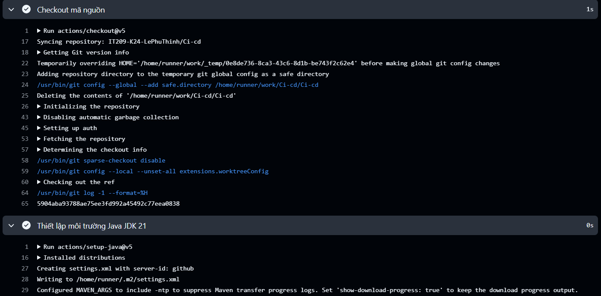

# BT02 - Biên dịch đóng gói tệp ứng dụng .jar với Gradle và lưu trữ Artifacts

## 1. Nội dung tệp .github/workflows/ci.yml

Bổ sung 2 bước `./gradlew bootJar` và `actions/upload-artifact@v4` vào Job test của bài 1:

```yaml
name: Java Spring Boot CI (Gradle)

on:
  push:
    branches: [ "main" ]

jobs:
  test:
    name: Run Unit Tests
    runs-on: ubuntu-latest

    steps:
      - name: Checkout mã nguồn
        uses: actions/checkout@v5

      - name: Thiết lập môi trường Java JDK 17
        uses: actions/setup-java@v5
        with:
          java-version: '17'
          distribution: 'temurin'

      - name: Cấp quyền cho Gradle Wrapper
        run: chmod +x gradlew

      - name: Thực thi JUnit Test với Gradle
        run: ./gradlew test

      - name: Đóng gói tệp JAR với Gradle
        run: ./gradlew bootJar

      - name: Lưu trữ thành phẩm JAR Artifact
        uses: actions/upload-artifact@v4
        with:
          name: app-jar
          path: build/libs/*.jar
```

## 2. Push commit mới lên nhánh main

```bash
devops@0310263186:~/demo$ git add .github/workflows/ci.yml
devops@0310263186:~/demo$ git commit -m "ci: đóng gói bootJar và upload artifact app-jar"
[main 2d5e9b4] ci: đóng gói bootJar và upload artifact app-jar
 1 file changed, 7 insertions(+)
devops@0310263186:~/demo$ git push origin main
To github.com:IT209-K24-LePhuThinh/SS11-BT02.git
   8f3c1a7..2d5e9b4  main -> main
```

## 3. Kết quả trên tab Actions

```text
Java Spring Boot CI (Gradle) #2
Triggered via push 1 minute ago
2d5e9b4 main

Run Unit Tests    Success    1m 28s
```

Log bước `./gradlew bootJar`:

```text
Run ./gradlew bootJar
> Task :compileJava UP-TO-DATE
> Task :processResources UP-TO-DATE
> Task :classes UP-TO-DATE
> Task :resolveMainClassName
> Task :bootJar
> Task :jar
> Task :assemble

BUILD SUCCESSFUL in 21s
4 actionable tasks: 4 executed
```

Log bước `actions/upload-artifact@v4`:

```text
Run actions/upload-artifact@v4
With the provided path, there will be 2 files uploaded
Artifact name is valid!
Root directory input is valid!
Beginning upload of artifact content to blob storage
Uploaded bytes 19342841
Finished uploading artifact content to blob storage!
SHA256 digest of uploaded artifact zip is 4c1e8d0a2f7b93c5e6a1d84f0b27c39e5a8d1f6402b3c7e9a5d2f8b1c4e70a93
Finalizing artifact upload
Artifact app-jar.zip successfully finalized. Artifact ID 1842917305
Artifact app-jar has been successfully uploaded!
```

Phần Summary của luồng chạy hiển thị artifact cho phép tải về:

```text
Artifacts
  app-jar.zip
  2 files: demo-0.0.1-SNAPSHOT.jar, demo-0.0.1-SNAPSHOT-plain.jar
  18.4 MB
```

Nội dung thư mục `build/libs/` sau khi đóng gói:

```bash
devops@0310263186:~/demo$ ls -lh build/libs/
total 19M
-rw-r--r-- 1 devops devops 18M Oct 14 09:41 demo-0.0.1-SNAPSHOT.jar
-rw-r--r-- 1 devops devops 4.2K Oct 14 09:41 demo-0.0.1-SNAPSHOT-plain.jar
```

## 4. Ảnh chụp màn hình


